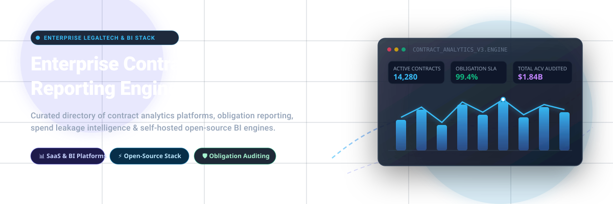

# Awesome Enterprise Contract Reporting Engine

  
  
  
  
  
  
  

  

> 📊 **A curated directory of enterprise contract reporting engines, AI-driven contract analytics platforms, obligation compliance trackers, and self-hosted open-source business intelligence (BI) systems.**

---

## 📑 Table of Contents
- [🌐 Sector Overview & Market Dynamics](#-sector-overview--market-dynamics)
- [🏢 Enterprise SaaS Platforms](#-enterprise-saas-platforms)
- [⚡ Open-Source GitHub Projects](#-open-source-github-projects)
- [🏛️ Key Architectural Distinction: CLM vs. BI Engine](#️-key-architectural-distinction-clm-vs-bi-engine)
- [📈 Star History](#-star-history)
- [💖 Support & Sponsorship](#-support--sponsorship)
- [🤝 How to Contribute](#-how-to-contribute)
- [⚠️ Disclaimer](#️-disclaimer)

---

## 🌐 Sector Overview & Market Dynamics

The global Contract Lifecycle Management (CLM) and contract analytics software sector is estimated at **$3.0B to $3.6B (2025–2026)** and expanding at a compound annual growth rate (CAGR) of **12% to 14%**, driven by large-scale enterprise adoption of AI obligation auditing, automated clause extraction, and regulatory compliance. The market is **moderately fragmented with accelerating platform consolidation**—characterized by a long tail of 150+ niche legaltech and vertical-specific point solutions alongside enterprise software giants (Microsoft, Alphabet/Google Cloud, Salesforce, SAP, IBM) that are consolidating core analytics layers to deliver end-to-end operational intelligence.

---

## 🏢 Enterprise SaaS Platforms

The table below benchmarks leading SaaS and enterprise platforms that power contract analytics and reporting, sorted by **company scale (Market Capitalization / Valuation / Revenue) in descending order**:

| Product | Company Size (Market Cap / Valuation / Revenue) | Description | Starting Price | Free Tier / Trial Limits |
|---|---|---|---|---|
| **[Microsoft Power BI](https://powerbi.microsoft.com/)** | **$3.89T Market Cap** ($331B+ ARR) | Microsoft's enterprise BI platform with desktop modeling and cloud publishing. Deep integration with Microsoft 365, SharePoint contract repositories, and Azure Synapse. Power BI Embedded powers customer-facing contract dashboards. | **$14/user/month** (Power BI Pro, billed annually) | **Free forever**: Power BI Desktop (free for authoring and local report creation); **60-day free trial** for Power BI Pro and Premium Per User (PPU) |
| **[Looker (Google Cloud)](https://looker.com/)** | **$3.64T Parent Market Cap** (Acquired for $2.6B) | Enterprise semantic data modeling platform built around LookML. Delivers governed self-service with unified contract metric definitions (e.g., ARR, TCV, renewal deadlines) across legal, procurement, and finance. | **$5,000/month** (~$60,000/year standard platform baseline); **$9/user/month** for Looker Studio Pro | **Looker Studio**: Free forever for basic cloud data visualization; **30-day free trial** for Looker Studio Pro; Custom sandbox PoC evaluation via Google Cloud sales |
| **[SAP Crystal Reports](https://www.sap.com/)** | **$247B Market Cap** ($45B+ ARR) | The industry standard for pixel-perfect, print-ready operational reporting and obligation notices. Directly connects to SAP HANA, MySQL, Oracle, MS Access, and ODBC sources with page-level layout control. | **$495** (one-time desktop perpetual license) | **30-day free trial** with full report creation, data connectivity, and export functionality |
| **[IBM Cognos Analytics](https://www.ibm.com/products/cognos-analytics)** | **$231B Market Cap** ($70B+ ARR) | Enterprise BI suite providing automated reporting, AI-assisted exploration, and operational dashboards. Tailored for enterprise organizations with strict data governance and existing IBM deployments. | **$10.60/user/month** (Standard Cloud tier) | **30-day free trial** for cloud multi-user environment with premium reporting modules |
| **[Tableau](https://www.tableau.com/)** | **$179B Parent Market Cap** (Salesforce; Acquired for $15.7B) | Leading visual analytics platform known for intuitive drag-and-drop dashboards and exploratory data analysis across complex contract and legal operational datasets. | **$15/user/month** (Tableau Viewer, billed annually; Creator license starting at $75/user/month) | **Tableau Public**: Free forever (public web publishing only); **14-day free trial** for Tableau Cloud Creator tier |
| **[MicroStrategy](https://www.microstrategy.com/)** | **~$30B Market Cap** ($500M ARR) | High-performance enterprise intelligence platform (MicroStrategy ONE) featuring governed semantic graphs, enterprise-grade mobile dossiers, and embedded contract analytics. | **$13/user/month** (Standard Cloud tier for authoring and analytics consumption) | **30-day free trial** with access to MicroStrategy Cloud Standard authoring environment |
| **[Qlik Sense](https://www.qlik.com/)** | **$10B+ Valuation** (Thoma Bravo; ~$800M+ ARR) | Associative analytics engine with in-memory calculation. Uncovers non-obvious relationships across multi-vendor agreements, supplier contracts, and pricing obligations without fixed query paths. | **$300/month** (Starter tier billed annually; includes 10 users and 10 GB data capacity) | **30-day free trial** with full access to Qlik Cloud Analytics features |
| **[Icertis Reporting](https://www.icertis.com/)** | **$3.5B Valuation** ($300M+ ARR) | Purpose-built contract reporting and obligation intelligence engine embedded inside the Icertis Contract Intelligence (ICI) enterprise CLM platform. Provides native metadata schemas and clause-level compliance tracking. | **$150/user/month** (Estimated baseline; typical deployments start at $88,000–$100,000+ ACV) | **No free-forever tier**; Proof-of-concept (PoC) sandbox trial provided upon sales qualification (typically 14–30 days) |
| **[Sisense](https://www.sisense.com/)** | **$1.0B Valuation** (~$150M ARR) | Cloud-native embedded analytics engine designed for product and engineering teams to embed white-label contract reporting dashboards directly into portals and B2B SaaS workflows. | **$2,083/month** (~$25,000/year entry-level self-serve contract tier) | **7-day free trial** for self-serve cloud dashboarding and developer playground |
| **[Domo](https://www.domo.com/)** | **$160M Market Cap** (~$310M ARR) | Full-stack cloud BI and data integration platform with pre-built data pipeline connectors, automated alert triggers, and mobile-first contract executive reporting dashboards. | **$2,500/month** (~$30,000/year consumption-credit baseline) | **30-day free trial** with credit allocation and unlimited user seats |

---

## ⚡ Open-Source GitHub Projects

Self-hosted, community-driven analytics platforms and semantic engines provide maximum data sovereignty, eliminating prohibitive per-seat licensing when querying sensitive contract databases. The projects below are sorted by **GitHub_Stars_Count in descending order**:

| Project | GitHub_Stars | Description |
|---|---|---|
| **[Apache Superset](https://github.com/apache/superset)** |  | **The leading enterprise open-source BI platform.** Apache-2.0 licensed. Offers a rich web SQL editor (SQL Lab), a no-code visual chart builder, fine-grained role-based security (RBAC), and broad connectivity to any SQL database behind CLM systems. |
| **[Metabase](https://github.com/metabase/metabase)** |  | **The fastest path to contract analytics for non-technical teams.** Free self-hosted edition with unlimited users, an intuitive visual query builder, and out-of-the-box connectors for PostgreSQL, MySQL, BigQuery, Snowflake, and Redshift. |
| **[Redash](https://github.com/getredash/redash)** |  | **Lightweight SQL-first dashboarding and automated alerting.** Browser-based schema explorer, customizable visualizations, scheduled data refreshes, REST API automation, and triggers on expiring contract terms. |
| **[Cube](https://github.com/cube-js/cube)** |  | **Universal semantic layer engine for contract analytics and metrics modeling.** Centrally manages contract calculations (ACV, ARR, renewal windows, obligation fulfillment) and exposes them through SQL and REST APIs to any BI front end. |
| **[Evidence](https://github.com/evidence-dev/evidence)** |  | **Code-driven business intelligence and markdown-based reporting.** Build version-controlled, audit-ready contract reporting websites and PDF summaries using pure SQL and Markdown. |
| **[Lightdash](https://github.com/lightdash/lightdash)** |  | **Open-source Looker alternative built natively on dbt.** Empowers data teams to define contract reporting metrics directly inside dbt models and deliver governed self-service dashboards to business stakeholders. |
| **[Rill](https://github.com/rilldata/rill)** |  | **Fast operational BI and real-time exploratory dashboarding powered by DuckDB.** Delivers sub-second queries and interactive dimension slicing across large contract repositories and spend datasets. |

---

## 🏛️ Key Architectural Distinction: CLM vs. BI Engine

Choosing the right reporting architecture depends on whether your organization requires native contract schema intelligence, pixel-perfect operational notices, or cross-database analytical dashboards:

1. **Native Embedded CLM Reporting (e.g., Icertis):**  
   Understands contract hierarchies (master services agreements, amendments, statements of work), clause variants, obligation timelines, and user permissions natively. Requires an enterprise CLM subscription.
2. **General-Purpose & Open-Source BI (e.g., Apache Superset, Metabase, Power BI, Looker):**  
   Connects to contract data warehouses, lakehouses, or relational application databases. Offers flexible cross-departmental correlation (linking legal contracts with ERP spend and CRM pipeline), but requires defining semantic metrics manually.
3. **Pixel-Perfect Operational Reporting (e.g., SAP Crystal Reports):**  
   Essential for generating formatted audit reports, formal renewal reminders, and regulatory obligation packages that must match exact print or PDF page constraints.

---

## 📈 Star History

---

## 💖 Support & Sponsorship

Thank you for visiting and using this curated directory! If you found this repository helpful in navigating contract analytics, reporting engines, or open-source BI infrastructure, please consider supporting the project:

- ⭐ **Star this repository** to help others discover it on GitHub.
- 🍴 **Fork and contribute** by submitting new tools, architectural guides, or benchmarks.
- 📢 **Share with colleagues** in legal ops, procurement, finance, and data engineering.
- ☕ **Sponsor or buy a coffee**: Support ongoing maintenance and research via the [GitHub Sponsors Dashboard](https://github.com/sponsors/ishandutta2007).

Your support keeps this ecosystem directory up to date and openly accessible to all teams! 🙌

---

## 🤝 How to Contribute

Contributions are welcome! Please follow these guidelines:

1. Fork the repository.
2. Update `README.md` following the existing tabular structure.
3. For SaaS entries: ensure specific pricing, detailed free tier / trial limits, and verified company valuation/market cap metrics are included.
4. For Open-Source entries: include the official GitHub_Stars_Badge (`style=social&color=white`) linked to the repository's stargazers page.
5. Submit a pull request with a concise summary of the changes.

---

## ⚠️ Disclaimer

- This is a community-curated repository intended for research, architectural evaluation, and legal ops benchmarking.
- Commercial contract terms, obligations, and pricing data represent sensitive corporate assets; always enforce proper role-based access control (RBAC), data encryption, and compliance with data sovereignty regulations.

---

  <b>Built with ❤️ for legal ops analysts, procurement leaders, and data engineering teams developing contract intelligence infrastructure.</b>

